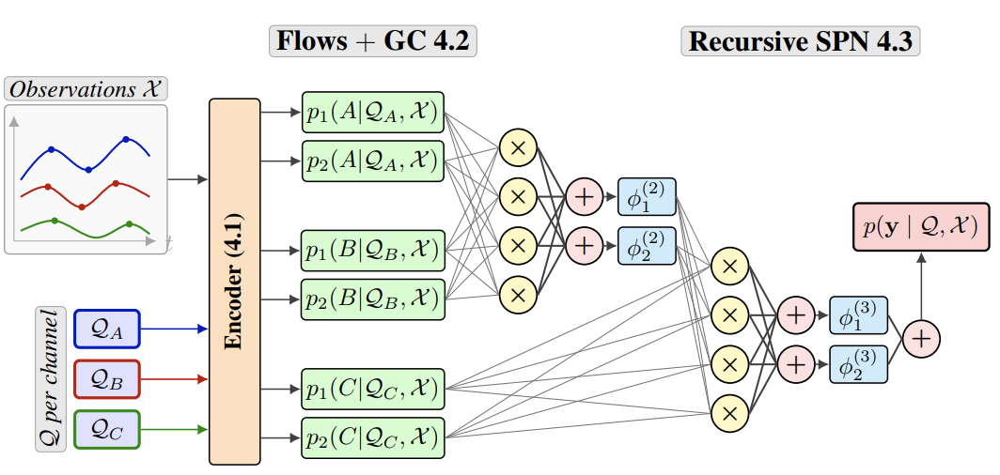
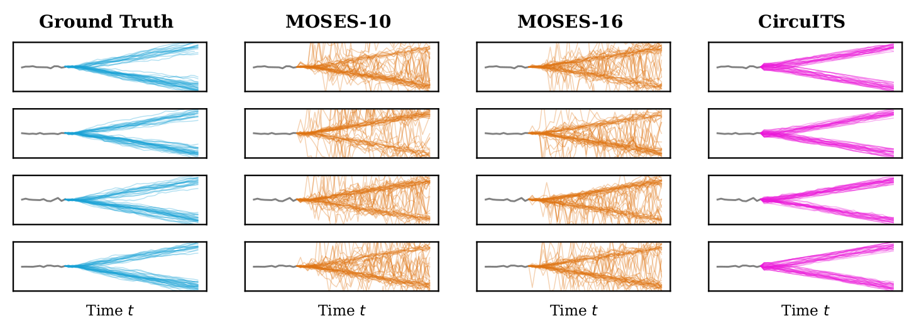

# CircuITS: Probabilistic Circuits for Irregular Multivariate Time Series Forecasting

This repository contains the official PyTorch implementation of the paper **"Probabilistic Circuits for Irregular Multivariate Time Series Forecasting"**.




### Prerequisites

The code is implemented in Python 3.11 using PyTorch.

Bash

```
pip install -r requirements.txt
```

### Datasets

The paper evaluates the model on four real-world datasets:

1. **USHCN:** Climate data (Precipitation, Snow Fall, Snow Depth, Max Temperature, Min Temperature ).
    
2. **PhysioNet-2012:** ICU mortality prediction data (37 vital signs).
    
3. **MIMIC-III:** Clinical database (96 variables).
    
4. **MIMIC-IV:** Updated clinical database (102 variables).
    

In addition, the repository supports **Human Activity** (UCI *Localization Data for Person Activity*, 12 variables: x/y/z positions of four body-worn tags), see [Section 3](#3-human-activity).


### 1. Synthetic Bifurcation Experiment




To reproduce the "Independent Multi-channel Bifurcation" experiment, which demonstrates CircuITS' ability to capture distinct modes where baselines like MOSES fail:

CircuITS:

```
python train_circuits.py --dataset bifurcation -ct 12 -ft 36 --plot
```

MOSES:
```
python src/baselines/moses/train_moses.py --dataset bifurcation -ct 12 -ft 36 --plot --n-gaussians 10
```

### 2. Real-World Benchmarks

To train and evaluate CircuITS on the benchmark datasets (Table 1).

To reproduce the USHCN 36-12 dataset for 1st fold run: 

```
python train_circuits.py --components 2 --hidden_dim 32  --flow_layers 2 --flow_hid_dim 10 --n_heads 2 --dataset ushcn -ct 36 -ft 12 -bs 64 --fold 0
```

Respectively for Physionet-2012, MIMIC-III and MIMIC-IV:

```
python train_circuits.py --components 4  --flow_layers 2 --flow_hid_dim 10 --hidden_dim 64 --n_heads 2 --dataset physionet2012 -ct 36 -ft 12 -bs 64 --fold 0
```

```
python train_circuits.py --components 4 --flow_layers 2 --flow_hid_dim 10 --hidden_dim 64 --n_heads 2 --dataset mimiciii  -ct 36 -ft 12 -bs 64 --fold 0
```

```
python train_circuits.py --components 2 --flow_layers 2 --flow_hid_dim 10 --hidden_dim 32 --n_heads 2 --dataset mimiciv  -ct 36 -ft 12 -bs 64 --fold 0 
```


**Hint**: Setting the parameter -ft (forecasting time) as 0 denotes the next-three-steps forecasting  scenario. -ct 36 -ft 3 would result in a different scenario (where the task is to predict the next three hours/months).  

### 3. Human Activity

The UCI *Localization Data for Person Activity* dataset (called *Human Activity* in [PyOmniTS](https://github.com/Ladbaby/PyOmniTS) and t-PatchGNN) is downloaded and preprocessed automatically into `~/.tsdm/`, no permission is needed:

```
python train_circuits.py --components 4 --flow_layers 2 --flow_hid_dim 10 --hidden_dim 64 --n_heads 2 --dataset activity -ct 36 -ft 12 -bs 64 --fold 0
```

Each record is cut into windows of 4000 ms with a stride of 4000 ms. That window takes the role of the 48 hours of the clinical datasets, so `-ct`/`-ft` are used on the usual scale:

| arguments | observed | forecast |
| --- | --- | --- |
| `-ct 36 -ft 12` | 3000 ms | 1000 ms |
| `-ct 24 -ft 24` | 2000 ms | 2000 ms |
| `-ct 12 -ft 36` | 1000 ms | 3000 ms |
| `-ct 36 -ft 0` | 3000 ms | next 3 observed timestamps |
| `-ct 3000 -ft 300` | 3000 ms | 300 ms (second PyOmniTS setting) |

Values of at least 100 are read as milliseconds directly, everything below is converted with 48 units = 4000 ms. The splits are made over records, so no window of a test record leaks into training. Fold 0 reproduces the split of PyOmniTS exactly (949 / 193 / 218 windows), the other folds shuffle the records. Unlike PyOmniTS, the 12 channels are standardized (as for the other datasets here); pass `normalize_values=False` to `tsdm.tasks.HumanActivity` to keep the raw coordinates.

